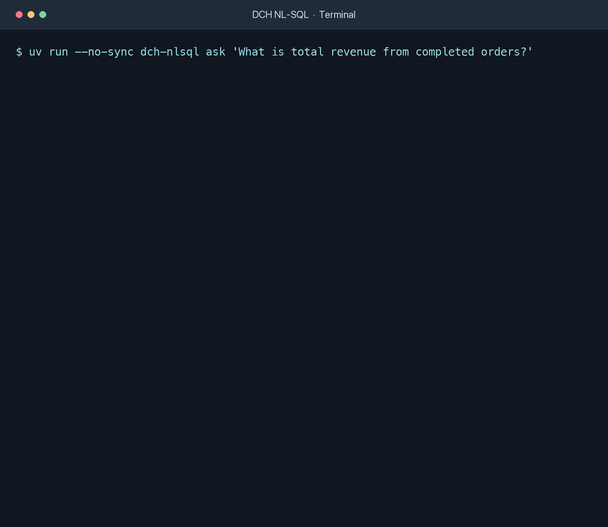

# Natural-language SQL through Data Connect Hub

Ask a question, generate SQL with an OpenAI-compatible model, and query your database through **Data Connect Hub (DCH)**. **LangGraph** coordinates table discovery, schema inspection, SQL generation, validation, database planning, execution, and one optional correction.

Schema discovery and query execution go through the DCH Python SDK. The model receives the selected schema and business descriptions. Results are printed locally with the SQL that produced them. Demo data is seeded separately, directly in PostgreSQL.



## Quick start

Run commands from the repository directory. You need:

- Python 3.11+, `uv`, and Git. The DCH SDK is installed from a pinned Git commit.
- A reachable DCH gateway, a tenant namespace, and a token authorized for that tenant.
- An existing PostgreSQL database reachable **from DCH**, with a PostgreSQL connection type available in DCH.
- An OpenAI-compatible chat completions endpoint and an API key if authentication is enabled. MaaS requires a valid MaaS API key.

The OpenShift `oc` CLI is optional. If you are logged in, the wizard can use it to discover missing DCH gateway/token defaults.

### 1. Install dependencies

```sh
uv sync
```

### 2. Prepare the demo tables

**Skip this step if you already loaded the demo data.** Run the seed against an existing PostgreSQL database using an account allowed to create schemas and tables:

```sh
bash scripts/setup_demo_db.sh \
  -h YOUR_POSTGRES_HOST -p 5432 -U YOUR_USERNAME -d YOUR_DATABASE
```

The script requires `psql` and prompts for a password when needed. It accepts standard PostgreSQL environment variables such as `PGSSLMODE` and `PGPASSFILE`. Alternatively, execute [examples/demo_db.sql](examples/demo_db.sql) in your PostgreSQL client's SQL editor.

The seed creates three related tables in `nlsql_demo`. Rerunning preserves rows with matching primary keys. It does not create a database or database roles, reset existing rows, or migrate incompatible tables.

### 3. Run guided setup

```sh
uv run dch-nlsql setup
```

The wizard saves settings in `.env`, checks database access through DCH, and can run a demo question. On reruns, press Enter to reuse saved settings or answer `n` to edit them. The [setup guide](docs/setup.md#guided-setup) explains each prompt.

### 4. Ask another question

Once setup succeeds:

```sh
uv run dch-nlsql ask 'What is total revenue from completed orders?'
```

For unmodified demo data, the answer is **USD 5,510.00**. Generated SQL and column aliases may vary.

DCH discovers tables and schemas automatically. Use `--table` to narrow the query or `--context` to supply business definitions.

## Common commands

```sh
# Inspect connections and the demo schema.
uv run dch-nlsql connections
uv run dch-nlsql schema

# Verify SQL execution without a model.
uv run dch-nlsql query 'SELECT COUNT(*) AS customers FROM nlsql_demo.customers'

# Generate and validate without executing SQL.
uv run dch-nlsql ask 'How many customers are there?' \
  --table nlsql_demo.customers --dry-run
```

## Documentation

- [Setup and troubleshooting](docs/setup.md) covers wizard prompts, environment variables, MaaS, manual connection registration, TLS, and credential Secret permissions.
- [CLI usage](docs/usage.md) covers commands and options, demo questions, and how to read results.
- [Architecture and development](docs/architecture.md) includes the workflow diagram, dependencies, component responsibilities, and test commands.
