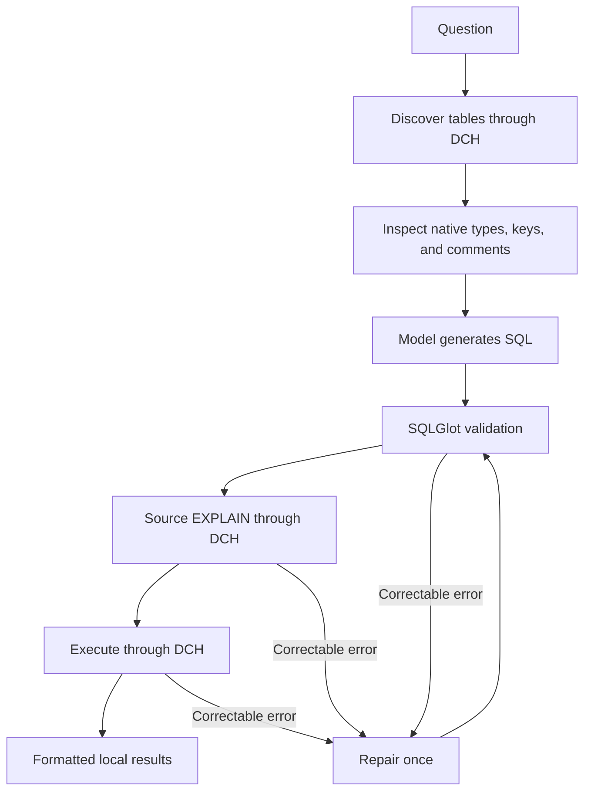

# Architecture and development

See the [quick start](../README.md#quick-start) to run the demo.

## Query workflow



SQLGlot validation and source planning run in one LangGraph step. The correction budget is shared across all checks. Unsafe SQL, access failures, and exhausted corrections stop the workflow. A dry run stops after source planning.

[nlsql/workflow.py](../nlsql/workflow.py) defines the LangGraph `StateGraph`. The DCH client, connection, model, dialect, table selection, and limits are fixed outside model-generated state. The model needs chat completions support; no tool calling, embeddings, or vector database is required.

The workflow follows the SQL-tool sequence of table discovery, schema inspection, query checking, and execution. The pinned DCH SDK has no dedicated primary/foreign-key methods, so PostgreSQL inspection uses two application-owned catalog SELECTs through `DataConnectClient.read()`, restricted to discovered tables. This retrieves native types, keys (including composite keys), and comments; Arrow transport strings are not treated as native SQL types. PostgreSQL catalog access is required, and incomplete or inconsistent metadata stops generation with an error. Other dialects currently use Arrow metadata without this PostgreSQL enrichment.

Validation requires one read-only SELECT, resolves physical tables and columns against metadata, rejects writes and functions outside a conservative allowlist, and applies the row limit. A source `EXPLAIN` checks types and expressions before the application query runs. The execution boundary validates SQL again. Parse errors, missing/ambiguous columns, selected unsupported pure functions/casts, and recognized source SQL errors share one correction attempt. Prohibited operations and access/transport failures stop. No rejected draft is used as an execution probe. Raw DCH exception bodies and query plans are never forwarded to the model; corrected SQL must pass every check again.

The question, selected schema, business context, and correction feedback go to the configured model. Tokens and result rows are not added to model prompts. The sample configures no checkpointer, conversation memory, result-summary call, or remote tracing. If you enable framework tracing, review what its destination captures.

### Reused libraries and custom code

| Component | Actual reuse |
| --- | --- |
| DCH Python SDK | Connection management, token/tenant handling, Flight table discovery, catalog reads, planning requests, and query execution. The SDK is pinned in `pyproject.toml`. |
| LangGraph | `StateGraph`, per-query runtime context, and conditional routing for the bounded correction loop. |
| OpenAI Python SDK | Chat completions and model discovery against the configured compatible endpoint, including MaaS. |
| SQLGlot | SQL parsing, scope/column resolution, identifier handling, row-limit rewriting, and SQL formatting. Validation policy is application code. |
| PyArrow and pandas | Flight schema decoding and query result containers, supplied through DCH's Flight dependencies. |
| Rich | Terminal tables, SQL highlighting, and transient progress spinners. |
| python-dotenv | Loading and saving local configuration. |

The DCH metadata adapter, PostgreSQL catalog queries, reference DDL, generation prompts, validation policy, source `EXPLAIN` check, correction routing, CLI/setup wizard, and demo data are custom code in this repository. The model generates SQL; LangGraph controls the sequence of operations.

`langchain-ibm` and `ibm-watsonx-ai` were consulted for their table/schema/check/query workflow and extended-metadata representation. They are design references only: their SQL toolkit and Flight client are not runtime dependencies, and no source code from either package is copied or vendored here. Their Flight discovery uses watsonx-specific commands and connection assets; this implementation retains DCH's SDK and connection model.

| Code | Responsibility |
| --- | --- |
| [workflow.py](../nlsql/workflow.py) | LangGraph nodes, trusted query context, progress events, and correction routing. |
| [schema.py](../nlsql/schema.py), [metadata.py](../nlsql/metadata.py) | DCH discovery, PostgreSQL native metadata, keys/comments, and reference DDL. |
| [service.py](../nlsql/service.py), [validation.py](../nlsql/validation.py) | Model requests, local SQL checks, source planning, and DCH execution. |
| [cli.py](../nlsql/cli.py), [setup.py](../nlsql/setup.py), [setup_ui.py](../nlsql/setup_ui.py) | Commands and guided configuration. |
| [connections.py](../nlsql/connections.py), [model.py](../nlsql/model.py), [diagnostics.py](../nlsql/diagnostics.py) | Connection lifecycle, model authentication/discovery, and safe diagnostics. |
| [output.py](../nlsql/output.py) | Result presentation and progress spinners. |

### Scope and limits

- The guided demo targets PostgreSQL. Other connections require provider support for DCH Flight SQL metadata, including serialized Arrow column schemas, and a supported SQL dialect.
- SQL checks and table selection are not an authorization boundary. Use read-only source credentials and database permissions for the intended tables, columns, and rows; metadata visibility may differ from query permissions.
- Row limits do not bound database scans or runtime. Set source-side statement/resource limits; a Flight timeout does not guarantee database-side query cancellation.
- SQL validation cannot guarantee that a model answered the question correctly. Review generated SQL and business assumptions. Narrow large schemas with `--table`.

## Development

```sh
uv sync --extra dev
uv run pytest -q
uv run ruff check .
uv run ruff format --check .
```

Tests exercise the compiled LangGraph and real Arrow metadata serialization with mocked DCH and model clients. They cover setup, connection routing, validation, correction budgets, diagnostics, credential handling, and isolation between queries. Tests do not require live cluster credentials.

## References

- [DCH SDK query example](https://github.com/opendatahub-io/data-connect-hub/blob/6d58bc9975a431c8f8a9040e610520d20c980f36/sdk/python/examples/flight_query.py)
- [DCH SDK connection example](https://github.com/opendatahub-io/data-connect-hub/blob/6d58bc9975a431c8f8a9040e610520d20c980f36/sdk/python/examples/connections.py)
- [LangGraph Graph API](https://docs.langchain.com/oss/python/langgraph/graph-api)
- [LangGraph SQL workflow example](https://docs.langchain.com/oss/python/langgraph/sql-agent)
